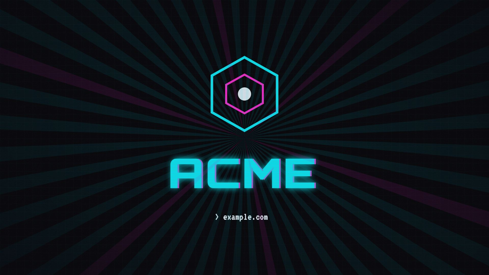

# remotion-eva-template

An Evangelion-inspired title sequence as a [Remotion](https://www.remotion.dev/)
template: hard-cut title cards, duotone photo cutouts over a grid floor, strobe
cuts, CRT flicker and scanlines, a typewriter boot, and a logo lockup. 30
seconds, 1920×1080 @ 30fps.



## Quickstart

Use Node.js 22.12.0 or later (CI uses Node 22; the dependency refresh was also tested
on Node 24). Rendering on macOS requires macOS 15 or later; see Remotion's
[system requirements](https://www.remotion.dev/docs/#system-requirements) for
supported Linux environments and required system packages.

Click **Use this template** on GitHub (or `npx degit millsmillsymills/remotion-eva-template my-intro`), then:

```bash
npm ci
npm run studio   # live preview
npm run render   # out/intro.mp4
```

Before sharing changes, run `npm run check`, `npm test`, and `npm audit`.
The CI render smoke test is
`npx remotion render src/index.ts intro out/smoke.mp4 --frames=0-9`.

## Make it yours

Three files to edit, in order:

1. **`src/intro/brand.ts`** — wordmark, tagline, logo path, optional soundtrack. Keep the
   wordmark short (~10 characters) or reduce the lockup font size in `src/intro/Lockup.tsx`.
2. **`src/intro/sequence.ts`** — the storyboard. A typed array of beats
   (`boot`, `card`, `still`, `strobe`, `lockup`) with frame timings. Rewrite
   the copy; retime or reorder beats freely — the composition duration is
   derived from the array.
3. **`src/intro/palette.ts`** — the accent colors, if cyan/magenta isn't you.

### Replace the images

Placeholder art lives in `assets/cutouts/` (portrait alpha PNGs, floated over
the grid floor) and `assets/stills/` (full-frame). Point the `STILLS` map in
`sequence.ts` at your files.

To give your own photos the duotone treatment:

```bash
node scripts/duotone.mjs your-cutout.png cyan assets/cutouts/your-cutout-cyan.png
node scripts/duotone.mjs photo.png "#030308,#ff2bd6" assets/stills/photo-magenta.png
```

Accents: `cyan`, `magenta`, `phosphor`, `amber`, `purple`, `red` — or pass an
explicit `#shadow,#highlight` pair. The script treats colors only; it does
**not** remove backgrounds. Make cutouts first with whatever you have (macOS
Preview's Remove Background, [rembg](https://github.com/danielgatis/rembg),
remove.bg), then treat them.

Regenerate the stock placeholders any time with
`node scripts/duotone.mjs --placeholders`.

### Add a soundtrack

Renders are silent by default. Drop your track at `assets/track.mp3` and set in
`brand.ts`:

```ts
track: { file: 'track.mp3', offsetSec: 0 },
```

`offsetSec` is where in the track frame 0 lands — nudge it until a downbeat
hits the first flash cut (frame 75, t=2.5s). The track fades out over the
final frames automatically.

`assets/track.mp3` is gitignored on the assumption the audio isn't yours to
redistribute; if it is, delete that line from `.gitignore`.

### Fonts

| Role | Face | License |
|------|------|---------|
| Boot / tagline | VT323 | OFL |
| Cards | Press Start 2P | OFL |
| Lockup wordmark | Orbitron | OFL |

All bundled in `assets/fonts/` with their OFL texts. To swap a face: add the
ttf to `assets/fonts/`, register it in `src/intro/fonts.ts`, reference the
family in the component.

## License

Code, textures, and placeholder images: [MIT](LICENSE). Fonts: SIL Open Font
License (see `assets/fonts/*-OFL.txt`).
